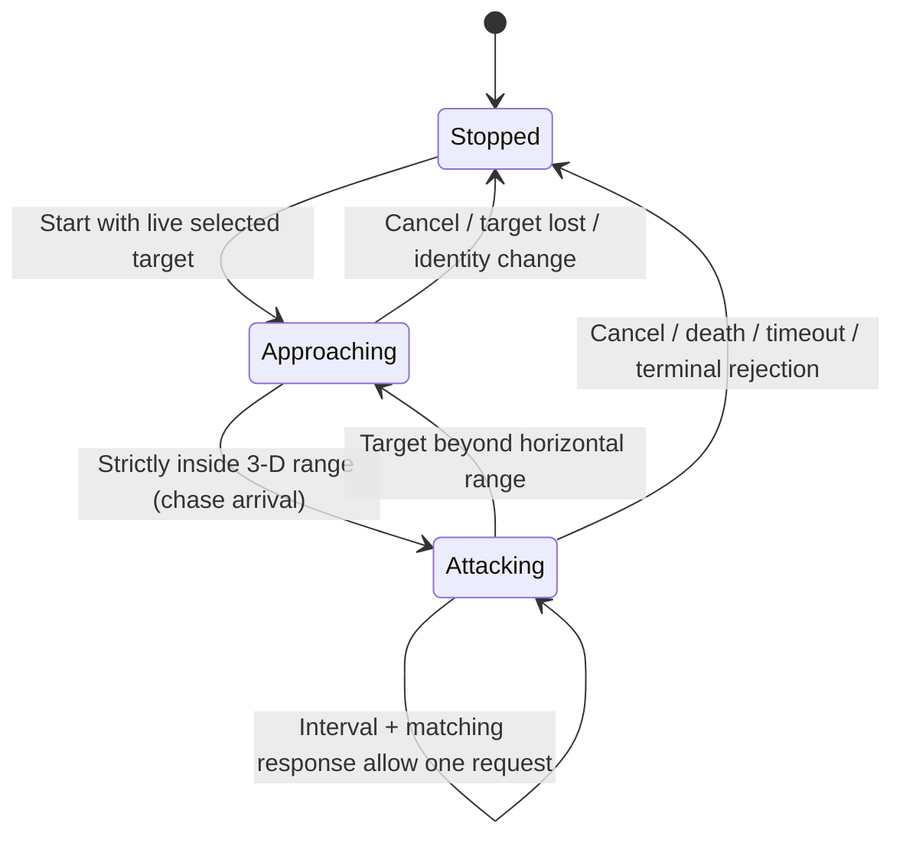

# Optional melee interaction (N3M1)

The manifest's optional `melee` object adds hashed `melee.bin` and requires
engine 4 (or 5 when combined with [damage](damage.md)). Protocol stays 1 for N3G1/2 or 2 for N3G3 movement. Engine 4 may include
camera data; older engine 1–3 releases retain their exact compatibility rules.
Both readers reject missing/extra policy files, malformed bounds, or mismatched
compatibility. No wire or database migration is needed.

`N3M1` is followed by four little-endian f32 values in this order:

| Field | Bounds | Meaning |
|---|---|---|
| `actor_radius` | 0.1–5m | Explicit player gameplay radius |
| `target_radius` | 0.1–5m | Explicit supported NPC template gameplay radius |
| `reach` | 0–5m | Additional melee reach |
| `facing_dot` | 0–0.99 | Strict client facing threshold |

Values must be finite; there are no trailing bytes. Radii are independent of
static collision dimensions and visual mesh extents. The supported one-action,
one-NPC-template vocabulary remains. This does not add equipment or PvP.

When enabled, the server checks horizontal origin distance against
`(actor_radius + target_radius) / 2 + reach`, inclusive. Client presentation turns
toward the target, requires normalized horizontal facing dot strictly above the
configured threshold, and chases a target beyond the horizontal range as KO's
attack tick does (`004659b0`, PQ-145): it walks until the target is strictly inside
the range measured in 3-D. It aims 5% inside but stops on the first step that
is strictly inside, so on level ground it ends anywhere in [0.95, 1) × range;
D-094's authoritative-position check below keeps it from spending an interval on
an early request at the edge. A request still goes out whenever horizontal range and facing
hold, also during the chase. A height difference beyond the range means the chase
never arrives (the player walks to the target's ground position), as in KO. Co-located entities need no facing turn. Server facing is not a
security claim: no facing field exists in the wire contract. No LOS, vertical
reach restriction or obstacle pathfinder is added. NPC AI retains its old rules.

Existing gameplay `cooldown_ticks` (1–1200 at 20Hz) determines both repeat pacing
and authoritative cooldown. `cost` may be zero only in releases with this policy;
positive costs still debit resources and reject insufficient resources. Legacy
releases continue to require positive cost and use their 3D `range` field.
The older `range` field remains validated but is unused for player melee when
this policy exists. Damage is fixed unless the optional damage policy is present; durable reward semantics remain unchanged.

The client owns the repeat intent: one selected runtime ID and at most one
outstanding request while active, with no catch-up queue. It sends ordinary
independently sequenced actions, waits for a matching response, and schedules the
next attempt no sooner than the package interval after sending. Hits and misses finish one attempt. Range/cooldown
rejections may retry at that interval. Other rejections or a two-second response
timeout stop intent. Stop/start preserves the local next-send deadline. Delayed
responses from cancelled requests cannot restart intent.

D-094 additionally requires the latest authoritative actor position to be in
horizontal range of the same target before sending. Predicted range and facing
must also pass. This prevents spending a whole weapon interval on an early request
while movement prediction is ahead of the server. Waiting for confirmation does
not reserve an interval; successful sends, misses and rejections keep their existing
pacing. The local pose still starts from the authoritative strike snapshot; exact
binary local swing prediction remains a separate presentation gap.

Manual WASD/ground movement, changing targets, chat/UI keyboard capture,
focus loss, actor death/identity change, missing/dead target, disconnect and
reconnect cancel; Esc does not (PQ-010). Selecting another target requires a new start. There is no
server attack loop to survive disconnect. A request already handed to the network
may resolve after stop; stop cannot retract a hit already accepted by the server.
The server always derives the actor from authentication and checks session,
action sequence, live target, range, cooldown, cost and pending reward state.

## Selected-target ready presentation

Keyboard selection (Z nearest enemy, X party member, B nearest NPC; PQ-009) faces the local player toward the selected live NPC without
starting attack intent or sending an Action. A selected live NPC requests the
ready stance whenever the local player is stationary and alive. Locomotion,
server-reported strikes and death take priority; after a strike, the player returns
to ready while the target remains live. Target loss/death or reconnect clears it.
Mouse selection also requests ready, while the keyboard selection explicitly turns.
Turning is immediate local presentation; no remote orientation/state wire field
is introduced. Stopping attack intent leaves the selected-target ready stance.

An engine-4 melee package's complete `presentation` set may add
`player-ready.bin`, a hashed N3S1 looping clip sharing the player's atlas. Both
release readers require melee and the existing complete player/HUD set. The
client loads/validates the clip normally. This is optional: old packages retain
idle fallback, and older binaries reject the new extra asset instead of guessing
its role. The synthetic player uses raised arms when ready without imported assets.
This adds the requested KO-03 ready stance, not the later full animation graph.

D-095 adds optional local cosmetic prediction for engine35/wire28 packages.
Eligible sends retain confirmed-range admission and normal request pacing. The
client predicts the swing, never its outcome; server-authored request identities
reconcile accepted strikes without restarting playback. Rejections and life/cast
transitions cancel pending cosmetics without refunding the legitimate send
interval. See [presentation events](presentation-events.md) for bounded history,
marker alignment, late confirmation and the authority boundary.
