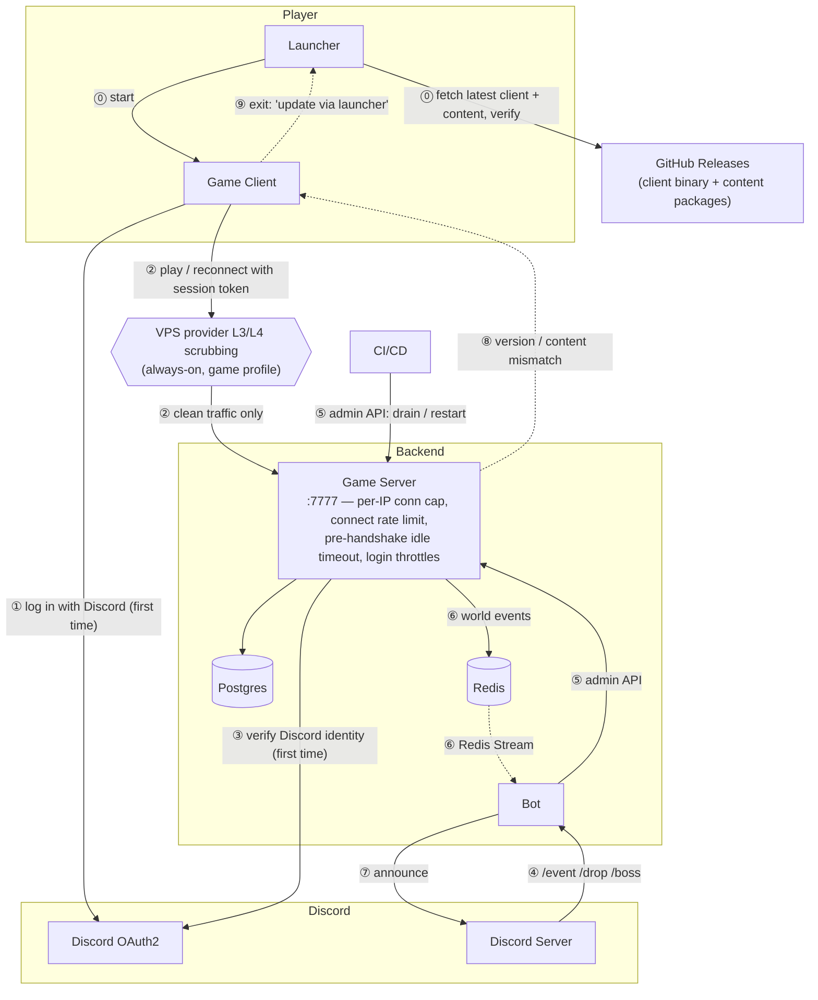
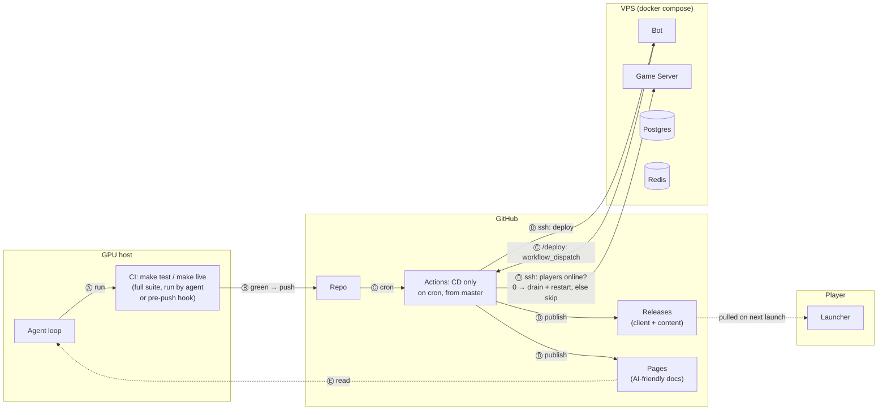
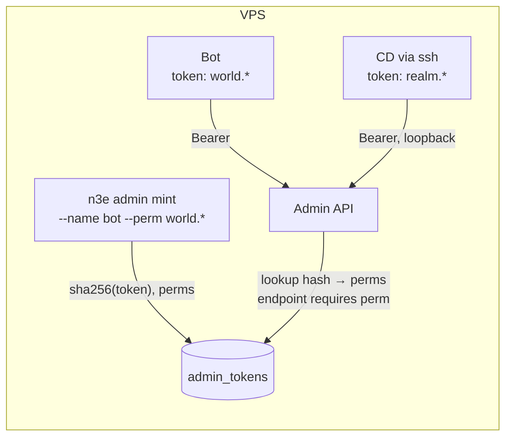
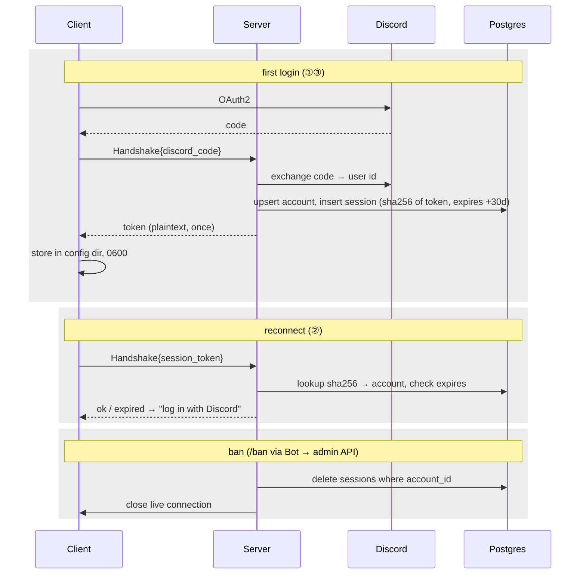
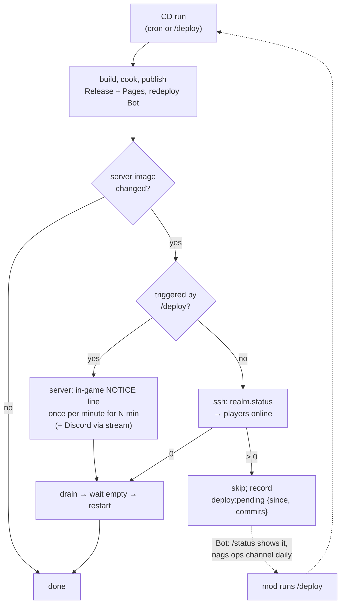
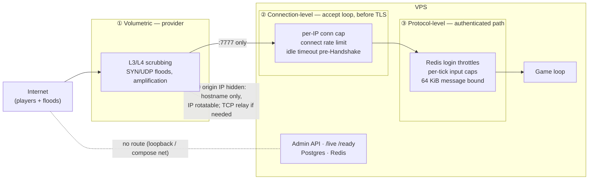

# n3e + Discord + agent-driven delivery

Implementation specs derived from this document live in [`specs/`](../specs/README.md); open questions in [`specs/QUESTIONS.md`](../specs/QUESTIONS.md).

## Runtime

## Delivery

## Flows

**Login** — ①②③: first login goes through Discord; the server exchanges the code for the Discord user id → account and returns a **session token** (30-day, opaque, revocable — O9). Reconnects present the token — Discord is not in the loop again until it expires or is revoked.

**Bot** — ④–⑦: plain automation, no AI. Slash command → bot → server admin API. World commands (`/boss`, `/event`) are driven by a catalog the server exposes from the loaded content package (spawn names, event presets); `/drop` is a preset, not a command. Server writes world events to a **Redis Stream**; bot consumes with a consumer group, so events survive a bot restart. If the admin API is unreachable (server draining or restarting), the Bot **fails fast**: it replies "server is restarting, try again in a minute" — with the reason, since CD announces deploys on the same stream. No queuing of world commands across a restart.

**Launcher** — ⓪: the player runs the Launcher, not the client. It reads the selected realm's manifest (client version, content hash, per-file content index, realm host/port and Discord `client_id`), downloads only the files it lacks from a content-addressed store, verifies hashes, writes the realm config, and starts the client. The client itself never downloads anything. One Launcher holds several **realm profiles**, so forks need no shared infrastructure.

**Mid-session update** — ⑧⑨: if the server restarts with a new version or content while a client is open, the handshake fails; the client exits with "update via launcher" and the launcher picks up the new Release on the next run.

**Admin API** — ⑤ has two callers: the Bot (spawn / drop / event) and CD (drain admissions → wait for empty → restart). One API, one auth scheme, **but two tokens with different permissions** — see O7. The Bot's token cannot drain or restart; the ops token never leaves the VPS (CD ssh-es in and calls the API on loopback).

**Delivery** — Ⓐ–Ⓓ: the Agent loop is the only AI component; it is separate from the Bot. **CI runs on a GPU host, not in GitHub.** The agent runs `make test` / `make live` (full suite, hardware GPU) before it pushes; a pre-push hook enforces the same for a human. GitHub Actions does **CD only**: on a cron it takes `master`, builds images, cooks content, publishes Releases + Pages, and ssh-deploys to the VPS (redeploy Bot, drain + restart Server). The realm restart is **gated on an empty realm** (O8): CD publishes every run, but only drains + restarts the server if the image changed *and* nobody is online; otherwise it skips and retries next cron. Mods can force it with `/deploy` from Discord. One realm restart per window at most, no matter how many commits the agent made. No self-hosted runner, no GPU in the cloud.

**Docs** — Ⓔ: CI publishes the repo's docs to GitHub Pages in an AI-friendly form (plain Markdown, `llms.txt` index, no JS-rendered content). The agent — and any other AI tooling — reads from there.

## Pushback

| # | Issue | Recommendation |
|---|---|---|
| 1 | Game Server has no admin API today. | Add one, loopback-only, permission-scoped tokens (O7). Never let the Bot write to Postgres directly. A leaked Bot token must not be able to drain the realm. |
| 2 | Who may spawn a boss? | Bot checks Discord roles; Game Server enforces its own roles as the real gate. |
| 3 | Server → Bot events (⑥). | Redis **Streams**, not pub/sub — pub/sub drops events while the bot is restarting. |
| 4 | **Deploying the Game Server kicks everyone.** One process = one realm; there is no rolling restart. | Bot and content can deploy anytime. Server restarts only happen on an empty realm, or on an explicit `/deploy` from a mod (announced, drained, restarted). See O8. |
| 5 | **Client and server are hash-pinned to the same content package.** | Solved by the Launcher. CI must publish the Release *before* restarting the server. **Releases on a private repo need a token to download** — the repo must be public, or releases live in a separate public repo. |
| 6 | **Client binary updates.** | Solved by the Launcher. Two things to keep in mind: (a) the Launcher updates itself too, so keep it tiny and boring so it rarely changes; (b) the Release needs a small **manifest** (client version + content hash) so the Launcher knows what "latest" means — CI writes it. |
| 7 | **What gates the agent?** Agent pushes straight to `master`; CI auto-deploys. | Accepted as-is for now. If it bites later: agent opens PRs, human merges, deploy only from `master`. |
| 8 | **Docs are a feedback loop.** If the agent reads docs the agent wrote, errors compound. | Docs are generated from the repo (`docs/`, `AGENTS.md`, `protocol/README.md`, `content/*.md` already exist), so they go through the same PR review as code. The agent reads Pages, but the *source of truth* is the repo at the commit it's working on — Pages is for external consumers. |
| 9 | **What triggers the agent?** | Claude Code `/loop` on the GPU host: periodic, unattended, picks up its own backlog. It is a scheduled janitor, not player-facing. |
| 10 | **CI capacity and deploy frequency.** | CI stays on the GPU host (the only machine with a GPU); Actions does CD only, on a cron. Public repo → unlimited hosted minutes anyway. |
| 11 | **Nothing in GitHub verifies what was pushed.** CI is now "trust that the agent/hook ran it." | Accepted (see #7). Cheap insurance: have CD run the headless `make test` (no GPU, a few minutes) before deploying, so a bypassed hook can't ship a broken build. **Depends on #12** — the hosted runner needs the full toolchain to build anything. |
| 12 | **CD must build the client binary on a hosted runner.** | Server/Bot build in Docker (Dockerfile exists). The client needs SDL3 ≥ 3.2, OpenGL headers, protobuf — Ubuntu 24.04's apt is too old for SDL3, so CD either uses `tools/bootstrap.sh`-style downloads or a prebuilt builder image. One-time setup; **a prerequisite for #11**, not optional. |
| 13 | **Single VPS, no HA.** One box runs Server, Bot, Postgres, Redis. An outage is an outage. | Accepted, same reasoning as the DDoS trade: a community server doesn't justify multi-node. Recovery story is O4 (nightly dump) + O6 (re-run CD on a fresh box). Write down the rebuild steps once so it's a 30-minute job, not an afternoon. |

## Operations

| # | Topic | Decision |
|---|---|---|
| O1 | **TLS** | Real domain + Let's Encrypt on the VPS (certbot or Caddy as a TLS terminator in front of 7777 is *not* an option — the server does its own TLS, so feed it the LE cert via the existing `N3E_CERT`/`N3E_KEY` mounts and restart on renewal). Client trusts the **system CA store**; `--ca` stays as a dev override only. Retires the 30-day local CA for prod. |
| O2 | **DDoS** | See below. |
| O3 | **Migrations** | CD runs `pg_dump` → `migrate` → drain + restart, in that order. A failed migration blocks readiness (existing behaviour); the Bot announces it. No automatic down-migrations — restore from the dump. |
| O4 | **Backups** | Nightly `pg_dump` off the VPS (S3 / R2 / any object store). Test a restore once. Content needs no backup — it's in Releases by hash. |
| O5 | **Secrets** | Runtime (VPS `.env`): DB password, Redis, Discord bot token, OAuth client secret, Bot admin token (O7), GitHub fine-grained token (`actions: write`, this repo only — for `/deploy`), TLS key. VPS-local only, not in `.env`: ops admin token. CD (GitHub Secrets): VPS ssh key — nothing else. **The agent holds none of these** — it writes code; it never deploys or runs against prod. |
| O6 | **Rollback** | CD tags every deploy (`deploy-YYYYMMDD-HHMM`). Rollback = re-run CD on the previous tag. Content packages are content-addressed, so old Releases remain valid; the Launcher just follows the manifest. DB rollback = O3/O4 restore. |
| O7 | **Admin tokens** | Permission-scoped opaque tokens, see below. |
| O8 | **Deploy gating** | Restart only on an empty realm, or on `/deploy`. See below. |
| O9 | **Sessions** | Opaque 30-day tokens in Postgres, revoked by row delete. See below. |
| O10 | **Repos & platforms** | One repo (`N3E-Realm`, imported from frozen `n3e`); raw KO assets as a pinned tarball; Linux + Windows clients in v1. See below. |
| O11 | **Content** | Package (Releases, per-file) vs. revision (Postgres, live) vs. raw input; event presets; community PRs. See below. |

### Repositories and platforms

| Topic | Decision |
|---|---|
| **One repo** | `Open-KO/N3E-Realm` holds engine, client, protocol, tooling, tests, content source, bot, launcher, CD and deploy. It starts as a clean, pruned import of the n3e engine at a pinned commit (no history carried; `specs/09-migration.md`) and depends on nothing outside itself afterwards. |
| **Raw KO assets** | Never in git. One immutable `.tar.zst` (~740 MB), sha256-pinned in `UPSTREAM.md`, stored as a Release asset, fetched into ignored `assets/ko/`. Only cooked output ships. A PR adding a KO-native file fails CI. |
| **Client platforms** | Linux and **Windows** x86_64 are v1 (the KO community is Windows). The client stays C++; the Windows port is build/TLS-trust/paths work, tested by a client-local smoke job on both OSes in CI plus a Discord canary role. Unsigned for now. macOS not v1. A Rust client is explicitly deferred — the recorded arguments for it (cross-compilation, a collision crate shared with the server) are real but not pre-launch work. |
| **Forks** | Everything a realm needs is in the repo. The Release manifest carries the realm's host, port and Discord `client_id`; the Launcher keeps **realm profiles** (name → manifest URL), so one Launcher can play several realms and a fork needs no shared infrastructure. |

### Content

Three kinds of world data, three homes. The rule of thumb: if changing it needs an artist or a table edit it is **package**; if an operator should be able to flip it on a Saturday night it is a **revision** property with a package-defined default and bounds.

| Kind | Where | Changed via | Restart | Reaches players via |
|---|---|---|---|---|
| **Package** — models, textures, animations, terrain, tables, archetypes, default rates, event *presets*, spawn *names* | `games/<game>/` in the repo, cooked to a hash-pinned package | PR → CD | yes, gated | Launcher, **per file** from a content-addressed store (weekly balance PRs must not mean full redownloads) |
| **Revision** — current multipliers, active preset, spawn positions, decorations, MOTD | Postgres, via the engine's existing editor/revision layer | admin API / Bot, or the in-game editor | no | wire (`Revision` in `World`) |
| **Raw KO input** | pinned tarball, see above | new pin | — | — |

**Event presets** are the answer to "what does `/drop` do": a preset is a named revision patch plus a duration, defined in the package (`events.json`), *activated* by an operator (`/event weekend-exp`), auto-reverted on expiry. KO's `/exp_add`/`/money_add` are the degenerate case (one global additive 0–15 %, untimed, announced on set and repeated at login); ours generalises and keeps both announcement behaviours. **A multiplier in effect is recorded on each settlement it affects** — n3e's reward path is audited and idempotent, and claim history must stay explainable; KO applies the bonus with no record and we do not copy that.

**Contributions** go through PRs with CI (cook, schema, provenance, size, no KO-native files). Contributed assets are CC-BY 4.0 with a mandatory `PROVENANCE.md` row; `CODEOWNERS` separates `games/**` from engine code. Scope for v1 is anything that fills an existing asset slot or table row; new zones from non-KO sources are not supported yet.

### Admin tokens

A small capability system rather than a password: permissions are strings, a token is a random secret bound to a set of them. Adding a caller later (a web dashboard, a second bot, a metrics scraper) is one `mint`, not a new auth scheme.

| Aspect | Decision |
|---|---|
| Permissions | Flat strings, one per capability: `world.catalog`, `world.spawn`, `world.kill`, `world.event`, `world.set`, `account.lookup`, `account.kick`, `account.ban`, `account.mute`, `realm.status`, `realm.drain`, `realm.notice`, `realm.deploy`, `token.mint`, `token.revoke`. (Restart is a compose action performed by CD, not a realm permission.) Each admin endpoint declares the one it requires. Glob `world.*` accepted at mint time, expanded to the concrete set. |
| Token | 32 random bytes, base64url. Server stores only `sha256(token)` plus `{name, permissions, created_at, last_used_at}` in Postgres. The plaintext is printed once by `mint` and never stored. |
| Mint / revoke | `n3e admin mint --name NAME --perm P...` and `n3e admin revoke NAME`, run on the VPS, talk to Postgres directly (no API token needed to bootstrap). Revocation is immediate — it's a row delete, no expiry logic, no signing keys. |
| Rotate | `mint` new, swap in `.env`, `revoke` old. Zero downtime. |
| Today's tokens | `bot`: `world.catalog`, `world.spawn`, `world.kill`, `world.event`, `account.*`, `realm.status`, `realm.notice` — deliberately **not** `world.set` (direct revision patching is an operator-on-the-box action). `ops`: `realm.*`. Neither has `token.*` — minting stays a human-on-the-box action. |
| Transport | API binds loopback / compose network only (unchanged). Token is a `Bearer` header. CD never holds the ops token in GitHub Secrets; it ssh-es in and reads it from a root-only file on the VPS. |
| Not doing | JWTs, expiry, per-token rate limits, audit log beyond `last_used_at`. Add if a third caller appears. |

### Sessions

The session token is the player's real credential after first login — scrypt passwords are gone from the path. Same philosophy as admin tokens: opaque, hashed at rest, revoked by deleting a row.

| Aspect | Decision |
|---|---|
| Token | 32 random bytes, base64url. Postgres `sessions`: `{sha256, account_id, created_at, expires_at, last_seen_at, client_label}`. Plaintext returned once, never stored server-side. |
| Lifetime | **30 days absolute**, no sliding window. Expiry is checked at connect time only — a live connection is already authenticated and is not kicked when its token ages out. Re-login goes through Discord again, which is also the periodic identity re-check (left the guild, deleted account). |
| Binding | Account id only. Not IP (players roam), not client version (handshake ⑧ covers that). |
| Concurrency | Up to 5 live sessions per account. Minting a 6th evicts the oldest. |
| Revoke | `account.ban` / `account.kick` (admin API, Bot token) → delete all sessions for the account **and** close the live connection. Player logout → delete that one row. Instant; no expiry logic involved. |
| Mute | `account.mute` (timed) drops the player's chat server-side — KO's authority-11 behaviour, the most-used moderation tool there — but unlike KO tells the player once. Sessions are untouched. Attack-disable (KO authority 12) is deferred until there is PvP. |
| Client storage | One file in the OS config dir, mode 0600. The Launcher never reads or writes it. |
| Transport | Only inside the TLS `Handshake` message. Never in a URL, log line, or Discord message. The existing Redis login throttle (30/IP/min) applies to token presentation as well. |
| Not doing | Rotation on reconnect, refresh tokens, device fingerprinting, JWTs. Rotation would introduce a lost-response lockout race; a 30-day ceiling plus ban-revocation is sufficient here. |

### Deploy gating

Publishing is always safe; only the server restart kicks players. So CD separates the two and gates the second.

| Aspect | Decision |
|---|---|
| Check | CD ssh-es in and calls `realm.status` with the ops token (loopback). `players == 0` → proceed. A player connecting between check and drain is handled by the drain itself (admissions already closed). |
| Skip | CD writes `deploy:pending = {since, commits_behind}` to Redis. The Bot shows it in `/status` and posts one reminder a day to the ops channel. Cleared on successful restart. |
| Force | `/deploy` (Discord role-gated) → Bot calls GitHub `workflow_dispatch` on the CD workflow with `force=true`. CD announces **in game** (yellow NOTICE line, once per minute — KO's `/serverdown` cadence) and in Discord via the stream, then drains + restarts regardless of player count. The Bot **does not** drain or restart via the admin API — the restart logic lives in CD only, and the Bot token stays `world.*`. |
| Cron | Can be frequent (hourly) since it's a no-op when nothing changed or someone is online. The realm still restarts at most once per run. |
| Not doing | Scheduled maintenance windows, rolling restarts, "hold" flags. Empty-realm + `/deploy` covers it. |
| KO reference | KO's `/serverdown N` is the per-minute yellow NOTICE we copy; its final `/down` has **no drain** — it suspends the main thread and closes sockets one per second with no message. Our drain-then-close with a reason is a deliberate improvement, not a parity gap. |

### DDoS

The KO community has a history of this, so it's worth being precise about the attack surface. After this design it is **one TCP port** — 7777 on the VPS. Everything else is someone else's problem:

| Surface | Who absorbs it |
|---|---|
| Launcher downloads, content, docs | GitHub (Releases / Pages) |
| Login identity | Discord |
| Bot | Outbound-only to Discord's gateway; no inbound port |
| Admin API, `/live` `/ready`, Postgres, Redis | Loopback / compose network only; never public |
| **Game wire :7777** | **You** |

For 7777, layered:

1. **Volumetric (the big floods):** pick a VPS provider with free, always-on L3/L4 scrubbing for game traffic — OVH's Game anti-DDoS and Hetzner's are the usual choices. Cloudflare is **not** an option here: raw TCP needs Spectrum, which is Enterprise-only (custom annual contract plus per-GB add-on); Pro/Business only unlock SSH/RDP/Minecraft. This is the only layer that stops a real flood; everything below is for the cheaper attacks.
2. **Connection-level, in the server:** per-IP concurrent-connection cap and connect rate limit at accept time, before TLS. A TLS handshake costs the server more than the client, so unauthenticated connections should be cheap to drop. Idle timeout before `Handshake` arrives (seconds, not minutes).
3. **Already there:** Redis login throttles (10/account/min, 30/IP/min), per-tick input caps, 64 KiB message bound. Note the password **scrypt** (160 MiB, two permits) was a CPU-exhaustion vector; Discord login removes it from the path.
4. **Hide the origin:** the game server's IP should never appear in Discord, docs, or the Launcher manifest in plain form if you can avoid it — use a hostname, and be ready to move the IP. If it gets bad, a cheap TCP relay (or a provider that offers one) in front lets you rotate without touching DNS TTLs.

What this design does *not* give you: L7 game-protocol scrubbing or multi-region failover. For a community server that's the right trade. If attacks persist past layer 1, the escalation ladder is:

| Step | What | Cost | Buys you |
|---|---|---|---|
| 1 | Provider scrubbing (OVH Game / Hetzner) | €0 | The plan. Stops real floods. |
| 2 | Second cheap VPS on another provider as a TCP relay | ~€5–10/mo | IP rotation, a second scrubbing network in front. Blind to protocol — it hides the origin, it does not filter. |
| 3 | Game-DDoS host or relay service (OVH Game dedicated, Path.net / TCPShield-style) | ~$20–100/mo | Game-aware L4 filtering, larger capacity. |
| 4 | Cloudflare Spectrum | Enterprise contract, four figures/mo+ | Not for a community server. |

Step 2 is the first time a gateway box would earn its place in the runtime diagram.

#### Decision, 2026-11-01: a home host behind Cloudflare's WebSocket proxy (Q64)

The realm runs on the maintainer's own machine (the realm host) instead of a rented VPS, with
the game wire carried as a WebSocket through Cloudflare (spec 12). Why:

- **Cost.** The maintainer has idle, powerful machines and wants no monthly bill. The
  VPS options checked on 2026-11-01 were all worse than expected: OVH's VPS range (the
  scrubbing provider this section names) was out of stock in every location; Hetzner
  Cloud had raised prices twice in 2026 (US 4 vCPU/8 GB about €63/mo) and showed its
  plans as unavailable; DigitalOcean ($24–48/mo) blackholes an attacked address instead
  of scrubbing it; Hostinger was $24.49/mo month to month.
- **A home connection cannot be exposed.** A port-forward publishes the home address
  with no filtering at all: a flood fills the household's line, and a new address from
  the ISP does not help while the hostname points at the house (dynamic DNS publishes
  the new one).
- **Cloudflare's "not an option" was about raw TCP.** Spectrum is still Enterprise-only,
  but WebSockets are proxied on the free plan and we ship the client, so the client can
  speak WebSocket. The game wire's own TLS runs inside it unchanged, so Cloudflare
  carries but cannot read it. With a Cloudflare Tunnel the host opens no inbound port
  and its address is in no DNS record: layers 1 and 4 above at €0, on a network far
  larger than any VPS provider's scrubbing.
- **The cost is work, not money:** a WebSocket transport in the client, a small bridge
  that hands the player's address to the server through PROXY protocol v2 (spec 01
  already accepts it), and the tunnel. Latency grows by Cloudflare's hop (roughly 5–20
  ms), and Cloudflare may drop long-lived sockets, which the session token's reconnect
  already covers.

The VPS path is not lost: spec 07 still describes it, and moving is a DNS change plus
the runbook. If the free plan's WebSocket limits (unpublished, Q65) or Cloudflare's
policy ever stop the realm, step 2 of the ladder (a relay VPS) or step 3 replaces the
edge.
