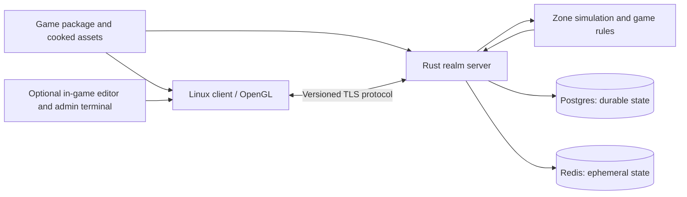

# n3e v0.1 design draft

Status: architectural baseline (2026-09-18), reconciled by current
CONTRACTS, STATUS and
DECISIONS. Phases 0–4 were delivered; on 2026-09-25
the user dropped the remaining phases 5–6 ([ROADMAP](ROADMAP.md)), and open work is
listed in the [gap register](GAPS.md). Older architectural proposals below retain
their dated context.

n3e is a reusable MMORPG engine with a native Linux/OpenGL client and an authoritative Rust server backed by Postgres and Redis. Games supply content and rules through versioned game packages. A client compiled with tools includes an in-game editor; an authenticated administrator character can also use an in-game command terminal to change supported server properties while the world is running.

v0.1 establishes this architecture through a small playable multiplayer game and a second, visibly different game package using the same engine binaries. It is an engine foundation, not a complete Knight Online recreation or a claim of large-scale production readiness.

The user-requested pre-Phase-4 KO audit makes
binary-grounded behavior an explicit fidelity gate for those scoped features,
with `games/demo` following KO as closely as practical. Generic engine boundaries
and the deferred-feature list remain; see D-021 for the current audit decision.

## Long-term feature roadmap

The long-term goal is to catalog KO features evidenced by the available source,
binaries/Ghidra and content, then progressively support them through generic
engine capabilities and package-defined rules. The accepted KO-00–13 work grounds
a bounded playable slice; it is not a complete feature inventory.

The KO-CAT survey preceded original Phase 4: a broad survey plus targeted
architecture-impact investigation (accepted catalog), followed by
Phase 4, bounded Moradon exploration/hold-Q turbo and incremental feature work
(D-041); phases 5–6 were later dropped ([ROADMAP](ROADMAP.md)). Weather/time is deferred beyond Phase 4; lighting satisfies
its visual publication gate. The deferred features below
remain outside v0.1; cataloging them does not authorize implementation or enlarge
release gates. Historical fidelity, engine support and evidence confidence are
separate questions. See D-038/040 and current STATUS.

The user-directed binary fidelity policy makes supplied binaries the
behavioral source of truth. Deliberate deviations require demonstrated logic bugs
or player exploits; existing simplifications remain explicit fidelity/support gaps.
The catalog indexes binary-only discoveries and per-role navigation without
claiming a matching release or expanding current implementation scope.

## Requirements and proposed defaults

The requested requirements are Linux + OpenGL, a `make` client build, Docker Compose server startup, a Rust server, Postgres + Redis, optional compiled-in editing tools, server-authorized administration, and reuse across different MMOs.

The following choices are proposed defaults, not additional user requirements:

| Area | v0.1 proposal |
|---|---|
| Client | C++20, SDL3, OpenGL 3.3 core, shader-based rendering |
| Build | GNU Make entry point wrapping CMake; independent normal/tools output directories |
| Editor and terminal | Dear ImGui integrated into the client; compiled with `TOOLS=1` |
| Server | Rust workspace, one modular server process per realm; Tokio for asynchronous I/O |
| Persistence | Postgres migrations and typed queries; Phase 0 proved a postgres worker, SQLx remains an untested candidate |
| Networking | TLS-protected TCP, bounded length-prefixed Protobuf messages, generated C++/Rust types |
| Simulation | Fixed 20 Hz authoritative tick; initial 10 Hz state publication |
| Content | Versioned game manifests, declarative rules, cooked assets, immutable base releases |
| Deployment | One realm per Compose deployment, plus Postgres, Redis, and a migration job |
| Initial scale | A measured target of 100 connected players in one test zone, not a supported MMO capacity claim |

Dependency versions will be pinned during implementation; this document does not assert that candidate libraries have already been integrated or benchmarked.

## What the reference projects tell us

Paths below are relative to this document. The actual Blender checkout in this workspace is at repository path `ref/ko-blender`, while the C++ checkout is `ref/ko-src`.

| Evidence inspected | Implication for n3e |
|---|---|
| OpenKO README and root CMake | The reference targets KO 1298/9 compatibility. Its non-Windows build disables client/tool projects. n3e needs a new client platform boundary and its own compatibility policy. |
| N3Base header and build | Device/window globals and Direct3D types cross engine interfaces; `_N3GAME` and `_N3TOOL` already distinguish builds. Preserve the tools concept, replace the platform/rendering coupling. |
| WarFare terrain, main game procedure | Terrain and substantial world/game orchestration are outside N3Base. Copying N3Base alone does not extract an MMO engine. |
| Ebenezer build, regions, AI NPC, DB agent | Gameplay, interest regions, AI, and persistence provide behavior references. Their process split is not required for the first Rust implementation. |
| Packet definitions | Legacy messages encode KO-specific concepts, including nations, knights, and skills. Create a versioned n3e protocol instead of exposing these as engine primitives. |
| Existing Compose | The inspected stack provisions SQL Server and database tooling. It is not the requested Rust/Postgres/Redis game deployment. |
| Blender parsers, tests, coordinate conversion | Useful independent format and transformation references; Blender itself must not become a client runtime dependency. |
| Character parser | It reads/discards some collision references and animation-part metadata. Successful visual import does not establish gameplay collision or full animation fidelity. |

The older Blender overview reverses the handedness description given by its README and conversion implementation. Conversion behavior must be established by fixtures for orientation, winding, joints, and animation, rather than by copying the overview's wording.

This inspection was a source/design review, not a full code audit or a successful build of either reference. Reference code and asset provenance must be recorded before redistribution: OpenKO describes its source origins and academic scope; the Blender addon declares GPL-2.0-or-later. The default distributable demo should use original fixtures. Direct source reuse and the engine's distribution license remain a concrete decision before implementation copies reference code.

## Reuse strategy and boundaries

Use the references to recover useful behavior, formats, and algorithms, and selectively adapt portable components after review. Implement Linux platform/rendering interfaces and the Rust server as new modules. Keep legacy conversion outside the engine runtime. Do not make binary compatibility with KO clients, servers, databases, or every historical asset variant a v0.1 requirement.

| Engine owns | A game package owns |
|---|---|
| Windowing, rendering, input, audio interface, asset loading | Models, textures, animations, sounds, UI presentation |
| Entities, transforms, replication, collision, spatial queries | Zones, spawn definitions, NPC archetypes, faction definitions |
| Generic stats, action/cooldown execution, inventory operations | Stat names, class templates, item definitions, damage parameters |
| Authentication, persistence, permissions, admin command execution | Starting characters, progression tables, enabled features |
| Editor selection, inspectors, validation, revision machinery | Editable properties, valid ranges, content-specific labels |

No engine code should require KO-specific nation IDs, class numbers, paths, opcodes, or table layouts. Each content reference uses a namespaced stable ID, such as `demo:creature/wolf`, rather than an array position or source filename.

v0.1 supports variation within a defined RPG feature set through data. It does not promise that arbitrary future combat models require no new code. Future games can add Rust rule modules through a narrow game interface; dynamically loaded native plugins and a scripting VM are deferred. The acceptance test for initial reuse is changing game packages without modifying or rebuilding engine binaries.

## Playable v0.1 scope

The primary demo contains one small outdoor zone with terrain, static props, an animated player, a hostile NPC archetype, and a spawn point. A player can authenticate, select/create a character, move, see nearby players, use local chat, attack an NPC, receive an item, die, respawn, and reconnect with durable progress intact. Combat initially includes one basic targeted action with server-controlled range, cooldown, damage, and rewards.

A second package changes the zone layout, character/NPC definitions, visuals, starting inventory, and combat parameters using the same client/server executables. It runs as a separate realm deployment. v0.1 does not mix different games in one simulated world.

Deferred features include a public admin web service, guilds, trade, auction houses, crafting, full quest scripting, large PvP wars, seamless world migration, distributed zone ownership, full KO terrain import, complex effects authoring, terrain sculpting, a launcher/patch CDN, and production account recovery. These remain possible extensions without becoming prerequisites for the first release.

## Runtime architecture



The server has internal modules for sessions, protocol, simulation, game rules, persistence, content, and administration. Keep these as library boundaries inside one deployable process. A dedicated AI service, login service, or message broker would add operational cost before the first workload justifies it.

Each zone has one simulation owner. Network tasks decode and validate envelopes, then send bounded commands to that owner. Database I/O runs outside the simulation tick. Completed operations return as explicit results; worker tasks never mutate world entities directly. Tick work and queues have budgets, with metrics and overload behavior instead of unbounded catch-up loops.

## Client and rendering

The client separates platform services, the renderer, assets, scene state, presentation, networking, and optional tools. SDL3 supplies Linux window/input/context integration; OpenGL functions are loaded through an explicit loader. SDL documents both [Linux platform support](https://wiki.libsdl.org/SDL3/README-linux) and [OpenGL context/function loading](https://wiki.libsdl.org/SDL3/SDL_GL_CreateContext).

The first renderer supports static meshes, skeletal animation, opaque/alpha materials, simple directional and ambient lighting, terrain chunks, frustum culling, and a basic HUD. It uses vertex/index buffers and shaders. It does not emulate the full Direct3D fixed-function state machine. Render interfaces expose engine handles and data, not D3D types or global graphics devices.

Use right-handed, Y-up world coordinates with meters as the engine unit. Camera forward is local -Z. Define matrix layout, quaternion order, winding, texture origin, and depth mapping in the asset/protocol contracts. KO input and Blender output each have explicit conversion adapters; unit scale must be calibrated against a fixture rather than assumed from legacy numbers. Client and server consume the same cooked collision geometry and world transforms.

Local movement predicts a kinematic capsule against static collision. Server snapshots acknowledge input sequence numbers; the client reconciles and replays unacknowledged input. Other entities interpolate buffered snapshots. Combat outcomes are server-authored. v0.1 does not implement rewind-based hit validation. Focus on reliable movement and visible correction before advanced prediction.

## Asset and content pipeline

```text
KO assets -> legacy import adapter --+
                                    +-> validated intermediate assets -> cooker -> game release
Blender/original assets -> glTF -----+
```

Adopt glTF 2.0 as the proposed mesh/material/animation interchange subset, with a versioned n3e manifest for world and gameplay metadata. glTF export alone cannot carry every KO animation marker, attachment rule, or collision property; those go into explicit sidecar metadata. A small native cooked format stores runtime meshes, animation tracks, decoded textures, collision, and dependency hashes. Runtime clients need neither Python nor Blender.

The proposed eventual KO conversion scope is a tested subset of `.n3pmesh`, `.n3shape`, `.n3chr` and its `.n3joint`, `.n3cpart`, `.n3cplug`, `.n3anim` dependencies, plus referenced NTF/DXT textures. Phase 1 D-012 explicitly limits delivered KO support to a synthetic static PMesh adapter; these real character/shape/texture variants remain unsupported and unverified. Bake one selected progressive-mesh LOD initially. Declare supported source variants and fail clearly for others. Start with an original heightfield zone; legacy world/terrain conversion is a separate future adapter.

The converter checks file lengths/count limits, index and bone bounds, reference cycles, path containment, and ambiguous case-insensitive legacy paths. Missing cosmetic resources may produce explicit placeholders; missing required collision, skeletons, or authoritative definitions block publication. Outputs include source hashes, converter version, warnings, and a reproducible manifest.

Required fixtures include an asymmetric static mesh, an attachment, a skinned character in bind pose and animated frames, texture orientation, winding/normals, and matching client/server collision. Synthetic fixtures keep CI independent of downloaded proprietary assets. Optional local reference assets expand coverage without being bundled by default.

A game package contains `game_id`, package version, compatible engine/protocol versions, a content hash, zones, archetypes, items, actions, presentation data, and allowed property schemas. Validation resolves all required references before either process enters gameplay. v0.1 clients receive the base release out of band and reject a mismatched content hash with a clear diagnostic; automatic binary asset distribution is deferred.

## Network and authoritative simulation

Handshake identifies protocol version, game ID, content hash, and client feature flags. Feature flags describe UI support, never privileges. On login, the server binds an account, selected character, realm, and session generation. The client cannot select another character's authority by placing an ID in an admin payload.

Use generated Protobuf schemas with explicit envelopes for authentication, character selection, movement input, action requests, snapshots, entity lifecycle, chat, editor patches, and admin commands. Fields include request IDs, sequence numbers, and revisions where relevant. Do not serialize native C++/Rust memory layouts. Unsupported versions are rejected before world entry; golden cross-language vectors verify compatibility.

The initial TCP transport trades some loss-related latency for simpler implementation. Bound frame sizes, decode depth, per-session rates, outgoing bytes, and queued requests. Coalesce obsolete snapshots before writing; disconnect persistently slow consumers. Cap bulk messages and keep asset downloads off the gameplay connection. Revisit UDP/QUIC using measured latency and bandwidth rather than building multiple transports in v0.1.

The server validates movement speed and elapsed time, finite values, collision, action range, cooldown, resource costs, ownership, and item operations. Animation strike markers support presentation timing; they cannot grant damage. A grid-based area-of-interest system sends spawn/despawn events and relevant snapshots, with full baselines on entry/reconnect. Client selection never grants visibility into entities outside its interest set.

v0.1 movement supports walking and sliding on bounded-slope heightfields/static obstacles; jumping, swimming, and general rigid-body dynamics are deferred. NPCs use idle/chase/attack/return behavior in a zone designed for simple walkability queries. Navigation around complex structures is outside the first test zone's scope.

## Postgres and Redis responsibilities

| Store | Data and consistency |
|---|---|
| Postgres | Accounts, credential hashes, characters, character roles, inventory, progression, durable spawn/world overrides, config revisions, command results, audit records |
| Redis | Expiring presence, session lookup cache, rate-limit counters, optional invalidation hints; all recoverable or disposable |
| Server memory | Active entities, AI state, current combat, input queues, interest sets, active content/config revision |

Postgres is the authority for acknowledged durable changes. Redis must not be the sole copy of inventory, admin roles, a world edit, or an accepted command. Redis Pub/Sub has at-most-once delivery, so it may carry hints but cannot carry the only copy of a required change. See [Redis delivery semantics](https://redis.io/docs/latest/develop/pubsub/).

Core tables use explicit relational keys and constraints: `accounts`, `characters`, `character_roles`, `inventory_slots`, `character_progress`, `world_revisions`, `world_overrides`, `config_revisions`, `admin_requests`, and `audit_events`. Every realm-dependent row has realm scope; game-defined durable fields have a schema version and validation rather than arbitrary unvalidated JSON. Base game definitions remain immutable package data. Unique item ownership and slot constraints prevent duplicate grants.

Inventory/reward/progression changes commit atomically before the client receives durable success. A unique operation ID makes retries return the original result. Conflicting inventory operations serialize per character and use database constraints/locking as a second boundary. Retry complete transactions when required by the chosen isolation level; [Postgres documents serialization-failure retry behavior](https://www.postgresql.org/docs/17/transaction-iso.html).

Position is checkpointed periodically (initially every five seconds) and on clean disconnect, so a crash may roll movement back to the last checkpoint. v0.1 does not promise persistence for every transient NPC or combat state. Already acknowledged item/progression changes must survive a process restart.

Postgres also enforces a renewable single-owner realm lease with a monotonically increasing generation. Durable writes verify that generation; a process that cannot renew stops accepting commands before lease expiry. Duplicate Compose instances must not operate the same realm concurrently. Character sessions have generations to reject stale connections and checkpoint writes after reconnect.

If Postgres becomes unavailable, stop new logins and durable/admin operations; pause gameplay that can grant or consume durable resources, and disconnect gracefully if recovery exceeds a bounded interval. Do not report success from a pending in-memory write. If Redis fails, active gameplay continues, cache misses consult Postgres where appropriate, and new logins fail closed until rate-limit/session infrastructure recovers. Authoritative role checks never depend solely on a Redis cache.

## In-game editing

`make client TOOLS=1` includes an editor overlay over the running game. Initial tools are entity picking, hierarchy/selection, transform gizmos, a property inspector, asset/prefab selection, preview lighting/fog, spawn placement, and validation feedback. Undo/redo applies to local drafts. Terrain sculpting, mesh/skeleton authoring, arbitrary code evaluation, and binary asset hot reload are deferred.

There are three edit scopes:

| Scope | Who may use it | Effect |
|---|---|---|
| Local draft | Any tools-build user | Unsaved preview or local project file; no shared simulation authority |
| Session operation | Character with the required capability | A temporary server action, such as spawning a test NPC; disappears on restart |
| Persistent publication | Character with `world.edit` for the target realm/zone | Validated revision stored in Postgres and applied to connected clients |

Local previews live in an overlay; they cannot alter authoritative collision or grant inventory. A user can edit an offline local project and export it as package source. In a connected world, attempts to publish without permission receive a server rejection even if the UI has been modified.

Live v0.1 publication covers transforms of non-collidable decorative props, prepackaged visual properties, and spawn definitions using already-present assets. Collision edits, new binary assets, scripts, and schema changes require a new cooked release and controlled restart. A draft can display an unpublished collision change but must mark it as requiring rebuild/restart.

Publication includes an expected base revision and a typed patch. The server checks permission, bounds, asset references, and conflicts, then stores the revision and audit event transactionally. At a tick boundary the zone activates that revision and broadcasts it. The response distinguishes `committed` from `applied` with revision and tick IDs. If the process crashes between those steps, startup loads the committed revision before accepting players. Reconnect delivers the current override snapshot.

Stale revisions fail with a diff; v0.1 has no automatic collaborative merge. Reverting a shared edit creates a new validated revision, so undo cannot silently overwrite someone else's later work. The editor can export base package plus overrides into a candidate release. Deployment must explicitly rebase/reset overrides against that new base hash to prevent applying them twice.

## Administrator terminal

In a tools build, selecting an admin character enables a terminal overlay after the server supplies its capabilities. The server checks the current character's role and operation scope on every privileged command; a local flag, account name, cached role, or possession of the tools build grants nothing. A normal build omits the terminal UI, while sharing the same validated protocol implementation.

The console provides command history, completion, typed arguments, help, request status, and structured output. It invokes registered domain commands. It does not expose a shell, arbitrary SQL, Rust evaluation, or database credentials.

Example proposed commands (not implemented; KO-13 property candidates (p4-tools evidence) supersede the original live XP-multiplier proposal):

```text
help
server get demo:lighting.intensity
zone set demo:meadow demo:lighting.intensity 0.75 --expect-revision 42 --reason "event tuning"
zone set demo:meadow demo:lighting.intensity 0.8 --expect-revision 18 --reason "lighting test"
spawn create demo:creature/wolf --at 12,0,8 --temporary
world diff --revision 19
world revert --revision 18 --expect-revision 19 --reason "restore placement"
```

A shared property registry defines type, bounds, scope, capability, persistence, and activation policy. Both inspector and terminal use this registry. Completion exposes only allowed commands; enforcement still happens server-side. Initial capabilities include `server.inspect`, `config.edit`, `world.edit`, and `entity.spawn`.

| Property class | Activation |
|---|---|
| Lighting/decorative visual overrides | Proposed next tick after durable revision commit; Phase 4 must implement activation |
| Reward curve/item/capacity/XP/eligibility/expiry definition | Immutable in a converted realm; reviewed forward migration and release/restart required (D-037) |
| Spawn position/respawn delay | Next spawn cycle; existing NPCs retain their current instance state |
| Decorative transforms/material parameters | Revision broadcast and client application |
| Listen port, database connection, simulation tick rate, collision assets | Report restart required; no live mutation |
| Secret material and role grants | Excluded from the initial in-game editing registry |

The first admin is provisioned with an operator-only server CLI against a specific account/character/realm. Do not give the first player automatic admin rights. Role revocation is authoritative in Postgres; privileged execution rechecks it transactionally, with ordering against concurrent revocation. Commands already committed remain auditable; later commands fail after revocation commits.

Every privileged mutation has a request ID, actor account/character, realm, target, expected revision, reason, before/after values, timestamp, and result. Deduplicate the mutation and its durable result together. Audit persistence failure blocks durable administrative success. Logs redact credentials and tokens. Failed/denied attempts produce bounded security logs; console history must not contain authentication secrets.

## Build, deployment, and repository shape

The following is the target repository layout. Phase 1 implements the root foundation paths and demo; later gameplay/tools/variant functionality remains pending (see STATUS):

```text
Makefile
CMakeLists.txt
client/                  # platform, renderer, assets, presentation, network
client/tools/            # optional editor and terminal
server/                  # Cargo workspace and realm executable
protocol/                # schemas, generated bindings, golden vectors
content/                 # shared schema definitions and validation contracts
tools/assetc/            # importer/cooker and conversion fixtures
games/demo/              # original primary game package
games/variant/           # second reuse demonstration
deploy/                  # images, config templates, migration entrypoint
compose.yaml
docs/
ref/                     # pinned reference checkouts
```

Planned developer interface:

```bash
make                         # builds the normal Linux client
make client TOOLS=1           # builds a distinct tools-enabled executable
make assets GAME=demo         # validates and cooks a game package
make test                    # relevant client/server/protocol/content checks
docker compose up --build    # starts the default demo realm and dependencies
./build/client-tools/n3e-client --game games/demo --server localhost:7777
```

The Make wrapper supplies explicit CMake options, isolates tools/non-tools caches, and honors parallel builds. Pin dependencies and Rust toolchain; document first-build downloads and Linux packages. The documented clean-machine flow includes content cooking and local credentials/certificate setup. Neither proprietary KO assets nor Windows tooling are required to build and run the default demo.

Compose contains `postgres`, `redis`, a one-shot `migrate` job, and `server`. Postgres has a named durable volume; Redis persistence is optional because it holds no sole authoritative data. The server mounts the cooked package read-only. Database ports stay internal by default, with the game endpoint bound to loopback in the development configuration.

Use health checks, wait for database readiness, and require successful migrations before server readiness. Compose supports both healthy-service and successful-completion dependency conditions; see [Docker startup-order documentation](https://docs.docker.com/compose/how-tos/startup-order/). Application reconnect logic is still required after startup. Never bake deployment secrets into images or packages. Local TLS uses an explicitly trusted development CA; do not teach the client to disable certificate validation.

Schema migration failure prevents readiness. A backup/restore exercise covers character state and world/config revisions. Graceful shutdown stops admission, drains pending durable operations, checkpoints players, and releases ownership. Metrics include tick duration, queue sizes, player counts, database latency, correction rate, rejected commands, and active revision. Detailed profiling stays optional.

## Acceptance criteria and evidence

All items below are release gates for the proposed scope, except performance numbers which are initial targets to confirm on recorded hardware.

| Area | Evidence required |
|---|---|
| Linux build | Clean documented Linux environment builds both variants through `make`; normal variant excludes editor/terminal UI. Smoke-test X11 and Wayland paths where available. |
| Deployment | Fresh Compose volumes reach readiness; repeat startup preserves characters and world revisions; failed migration never produces a ready server. |
| Playable loop | Two graphical clients complete login, movement, visibility, chat, combat, item grant, death/respawn, and reconnect. |
| Reuse | Demo and variant use identical engine executable hashes, with no KO-specific branching in engine modules. |
| Assets | Original fixtures pass coordinate, skinning, texture, dependency, and collision checks; supported optional KO fixture conversions have explicit reports. |
| Authority | Forged movement, rewards, role flags, malformed frames, and unauthorized editor/admin requests fail without corrupting state. |
| Persistence | Retrying a reward or admin request after connection loss does not duplicate it. A crash after durable acknowledgement loses no acknowledged reward or published revision. |
| Live editing | An authorized publication appears on a second client, survives restart, rejects stale revisions, and can be reverted as a new revision. |
| Admin | Non-admin denied; admin command applies at documented boundary; role revocation blocks later operations; results and before/after audit data are recoverable. |
| Failure handling | Exercise Redis restart, Postgres outage, server crash between commit/apply, slow client, content mismatch, and duplicate realm startup. |
| Cross-language protocol | C++ and Rust agree on golden messages and reject unsupported versions and oversized payloads. |

Initial load scenario: 100 synthetic players and 200 NPCs in one zone for 30 minutes, with documented spatial distribution and an all-in-one-interest-area case. Target p95 tick duration below 40 ms at 20 Hz on a recorded 4-vCPU/8-GiB server allocation, with bounded queues and no steady memory growth. Record p99 tick time and bandwidth as well. Run a separate 100 ms RTT/1% packet-loss scenario to expose TCP/prediction limits. These are hypotheses to validate, not observed results.

Client target: a representative demo view at 1080p/60 FPS on a named test GPU, with CPU/GPU times and entity/draw counts recorded. Select that hardware during the first rendering milestone; there is no credible universal performance promise yet.

## Decisions tracked by the implementation spec

1. Phase 0 retained C++20/SDL3/GL 3.3/ImGui after hardware evidence. Rust remains the required server language; see D-004 for measured coverage.
2. Confirm that v0.1 is a reusable playable foundation, with KO behavior/assets as references, rather than a complete compatibility port.
3. Phase 0 selected original synthetic fixtures. Select the richer demo assets and provenance-approved KO conversion fixtures in Phase 1; decide source reuse/distribution policy before copying code.
4. Confirm the proposed live-edit set: decoration, visual properties, spawns, and selected gameplay settings; collision and binary content updates require a new release.
5. Confirm the initial concurrency target and benchmark allocations. Phase 0 selected an NVIDIA GPU with Wayland/XWayland for graphical feasibility; performance and broader platform coverage remain unmeasured.

The phased implementation spec now defines task IDs, prerequisites, contracts, experiments, and acceptance gates. It starts with feasibility spikes, then proceeds through foundation, multiplayer, gameplay, tools, reuse, and validation. The decision register distinguishes accepted direction from unmeasured defaults. Each phase produces an executable demonstration and evidence before the next expands scope.
